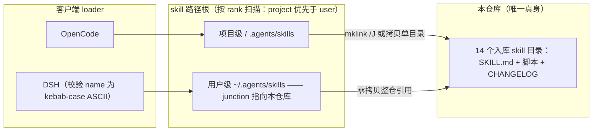

<div align="center">

# MachineVisionSkill

**AI 代理 skills 集合——覆盖工业上位机（视觉选型 / 报价 / 通讯 / 培训文档 / UI 设计稿与调试）与办公自动化（盖章 / PPT / docx / PDF / git 提交），兼容 OpenCode / DSH 的 skills 机制。**


每个 skill 目录自包含：`SKILL.md`（使用说明）＋ 脚本 + 资产 ＋ `CHANGELOG.md`（版本史），可独立安装使用。
名字叫 MachineVisionSkill 是因为起点是机器视觉选型——如今已生长为一整条工业上位机工具带，仓库沿用此名。

</div>

---

## 快速开始

```cmd
git clone https://github.com/lq700212/MachineVisionSkill.git
```

把需要的 skill 目录链接（或直接复制）到客户端 skills 根即可被识别，Windows 目录联接示例：

```cmd
mklink /J "C:\Users\Administrator\.config\opencode\skills\视觉硬件选型" "D:\path\to\MachineVisionSkill\视觉硬件选型"
```

直接复制目录同样可用。

### 先验证，再使用

仓库自带视觉选型的分层测试套件，clone 后可直接跑（纯离线，不碰网络与真实工作区）：

```bash
python 视觉选型测试/tests/run_all.py
```

当前基线 **144/144 通过、0 跳过**；只改了一层时可 `--layer smoke|data|doc|core|ppt|workflow`
按需快跑，交付前再跑全量。分层说明见 [视觉选型测试/SKILL.md](视觉选型测试/SKILL.md)。

### 挂到 DeepSeek Harness（DSH）：整仓零拷贝

DSH 的 skill 加载器扫描这些根目录（按 rank 递增，前者优先生效）：

| Rank | 来源 | 路径 |
|---|---|---|
| 100 | project-dsh | `<项目根>/.dsh/skills` |
| 200 | project-agents | `<项目根>/.agents/skills` |
| 300 | custom | `customSkillDirs`（配置项） |
| 400 | user-dsh | `~/.dsh/skills` |
| 500 | user-agents | `~/.agents/skills` |
| 600 | bundled | 随 DSH 安装的内置 skill |

把本仓库整体挂到 user-agents 根，`mklink /J` 一条命令全量接入：

```cmd
mklink /J "C:\Users\Administrator\.agents\skills" "C:\Users\Administrator\.config\opencode\skills"
```

接入要点（2026-08 起实测沉淀）：

- **用 junction（`mklink /J`）不用 symlink**：symlink 需要 Windows 开发者模式或管理员权限，且 git 会把 symlink 存成"链接文本"导致仓库白名单失效——已改 junction；
- **目录名不影响 DSH**：DSH 只认 `SKILL.md` frontmatter 的 `name` 字段，目录名可以保持中文；
- **改了 frontmatter 即时生效**：DSH 监听 skill 根目录，改完 `name`/`description` 下一轮就进会话目录，**不用重启**；
- **frontmatter 必须有 `name` + `description`**，缺任一项、或 `name` 不是 kebab-case ASCII（`^[a-z0-9]+(-[a-z0-9]+)*$`）的 skill 会被**静默丢弃**——中文名 skill 一律配一个 ASCII 调用名（见下表）。

## Skill 一览（14 个入库 skill）

| Skill 目录 | DSH 调用名 | 说明 | 使用文档 |
|-------|------|------|----------|
| [视觉硬件选型](视觉硬件选型/) | `vision-hardware-selection` | 机器视觉选型专家：相机/镜头/光源选型计算、方案 PPT 生成、官网产品图自动获取；光源只认官网库且型号可查证，口径歧义硬阻断，验收 FAIL 自动隔离 | [SKILL.md](视觉硬件选型/SKILL.md) |
| [视觉选型测试](视觉选型测试/) | `vision-selection-test` | 视觉硬件选型专用分层测试套件：smoke/data/doc/core/ppt/workflow 六层，144 条回归 + 注入用例，按改动选层快跑 | [SKILL.md](视觉选型测试/SKILL.md) |
| [git自动提交推送](git自动提交推送/) | `git-auto-commit-push` | 本地工程一键 commit + push：自动读 CHANGELOG 生成 message（含要点提炼），提交前安全检查（可联动仓库卫生体检），现场目录用显式暂存 | [SKILL.md](git自动提交推送/SKILL.md) |
| [winforms-ui-debug](winforms-ui-debug/) | `winforms-ui-debug` | 跨项目 WinForms 界面像素级调试：harness 指哪打哪直启目标窗体，反射探查 + 截图 + 像素扫描，附矩形枚举/置顶截图脚本 | [SKILL.md](winforms-ui-debug/SKILL.md) |
| [上位机通讯封装](上位机通讯封装/) | `hmi-comm-wrapper` | 上位机设备通讯范式：PLC/相机/仪表/Modbus 连接管理、心跳重连、UI 解耦 | [SKILL.md](上位机通讯封装/SKILL.md) |
| [上位机报价](上位机报价/) | `hmi-quotation` | 上位机项目报价全流程：IO表摸底→参考程序体检→市场调研→两本账人力→报价阶梯→核验 | [SKILL.md](上位机报价/SKILL.md) |
| [opencode-cache-cleaner](opencode-cache-cleaner/) | `opencode-cache-cleaner` | 清理 opencode 残留项目记录与孤儿快照：列出→选择→备份→删除→验证 | [SKILL.md](opencode-cache-cleaner/SKILL.md) |
| [盖章专员](盖章专员/) | `seal-stamp-agent` | PDF 合同自动盖章：自动匹配现有印章的大小与位置；支持文本版/扫描件 PDF、图片（拍照件）、Excel 工作簿四类输入 | [SKILL.md](盖章专员/SKILL.md) |
| [培训文档生成](培训文档生成/) | `training-doc-generator` | 工业上位机三份制培训文档：自动截图 → 操作员/客户技术工艺/内部版三份生成 | [SKILL.md](培训文档生成/SKILL.md) |
| [软件卸载清理](软件卸载清理/) | `software-uninstall-cleaner` | 通用软件彻底卸载与残留清理：进程→卸载→服务→目录/注册表/快捷方式 | [SKILL.md](软件卸载清理/SKILL.md) |
| [readme](readme/) | `readme` | 项目 README 标准生成流程：事实摸底→图片盘点→截图决策树→骨架落稿→八项卫生核验，图文并茂为默认形态 | [SKILL.md](readme/SKILL.md) |
| [viewturbo-checkin](viewturbo-checkin/) | `viewturbo-checkin` | ViewTurbo 每日签到领流量（真实账号文件永不入库，只提交 example 模板） | [SKILL.md](viewturbo-checkin/SKILL.md) |
| [scanner-config](scanner-config/) | `scanner-config` | 扫码枪 Eport-E10 串口联网模块网络配置与排障：改 IP/8899 端口、连接超时/169.254.x.x 诊断、恢复出厂重建，附 ScannerTool.ps1 | [SKILL.md](scanner-config/SKILL.md) |
| [ui-mockup-studio](ui-mockup-studio/) | `ui-mockup-studio` | UI 设计稿工作台 + 界面简化标准：基于 galaxy 组件库出 4-5 套可点击单文件 HTML 方案（主界面/子页/弹窗/跳转图/动效），内置 WinForms/WPF 双栈映射与信息预算 | [SKILL.md](ui-mockup-studio/SKILL.md) |

> 各 skill 的版本与变化记录见其目录内的 `CHANGELOG.md`。

### 本地安装、不入库（18 个）

以下 skill 随本机 opencode 直接加载、不在 GitHub 仓库跟踪范围内（clone 本仓库看不到它们的目录），仅供参考：

| 分类 | 调用名 | 说明 |
|------|--------|------|
| 演示与文档 | `ppt-master` | 原生可编辑 PPTX 生成/重构/美化：SVG→DrawingML、母版模板填充、旁白与动画（第三方，v6.9.0） |
| 演示与文档 | `ppt-merge` | 复刻模板母版到结果文件，基于结果母版建新页并复制内容形状 |
| 演示与文档 | `image-to-editable-ppt` | 图片/扫描版 PPT、PDF 重建为对象级可编辑 .pptx |
| 演示与文档 | `docx-cn-to-en` | 中文 .docx 批量翻译成英文，保留字体/加粗/列宽/拓扑图 |
| 演示与文档 | `pdf-analysis` | PDF 三步法：摸底→关键词定位→分页精读，结论带页码引用 |
| 工程与设计 | `solidworks-automation` | SolidWorks CAD 自动化：Python COM 建模/装配/工程图/钣金/焊件/仿真 |
| 工程与设计 | `pixel2motion` | 位图 Logo 转极简 SVG 并生成品牌动效（HTML 呈现） |
| 数据与批量改造 | `mes-station-master` | 多工站 Excel 标签表合并为 MES 数据总表（两行表头/字段映射/校验） |
| 数据与批量改造 | `multi-agent-batch-refactor` | 多 Agent 并行批量改造方法论（切分/模板/收口/假绿对策） |
| 记忆（Mem0 生态） | `mem0` | Mem0 Platform SDK：为 AI 应用加长期记忆（Python/TS/框架集成） |
| 记忆（Mem0 生态） | `mem0-cli` | Mem0 命令行：add/search/list/get/init/config/import |
| 记忆（Mem0 生态） | `remember` | 捕获"记住这个"请求并确保完整落库 |
| 记忆（Mem0 生态） | `forget` | 删除本仓库/本用户存储的 Mem0 记忆 |
| 记忆（Mem0 生态） | `search` | 检索早期会话记忆，避免重复读文件/搜索/实验 |
| 记忆（Mem0 生态） | `status` | 检查 Mem0 配置、采集状态、待刷写与 API Key 是否有效 |
| 记忆（Mem0 生态） | `resume` | 恢复被 `/mem0:pause` 暂停的记忆采集 |
| 记忆（Mem0 生态） | `pause` | 暂停本机 Mem0 记忆采集（私密工作/实验） |
| 元技能 | `cli-hub-meta-skill` | 发现面向 agent 的专业软件 CLI 实时目录 |

## 质量防线（本仓库的差异点）

这些 skill 不靠"提示词写得漂亮"，靠**脚本闸门**保证交付物可信：

| 闸门 | 机制 | 拦什么 |
|------|------|--------|
| 数据唯一源 | 硬件参数只从官网抓取并写入 `hardware_database.json`，带 `verified` + 官网链接 | 从型号名猜参数、按"品牌+尺寸+角度+颜色"拼造型号 |
| 选型核验 | 光源可查证性、内径覆盖、光源 WD < 镜头 WD、口径歧义硬阻断（exit 2） | 假型号进 PPT；客户公差被当成设备精度，算出 144px 的荒谬方案 |
| PPT 质检 | 当前选中型号白名单 + 旧型号/历史假型号黑名单 | 正确型号被误杀、旧型号残留、待选型占位符漏放 |
| 验收隔离 | 规则自查 FAIL 或验收异常 → PPT 自动移入 `output/_rejected/`，主流程非零退出 | "文件还在 output 里就被交付" |
| 分层测试 | 六层 144 条用例，bug → 用例一一沉淀，注入用例只迁移不删除 | 改 A 坏 B、文档与代码漂移、历史缺陷回流 |

原则：**脚本为主、AI 为辅**——每个可执行环节都有脚本，弱模型照脚本输出的 SOP 执行，
即得与强模型同款结果；AI 只做判断与文案，不碰"参数从哪来"。

## 架构



- **唯一实体归一**：全部 SKILL.md 只有一份真身（本仓库），其余位置一律 junction 指回——改一处即热更新到所有客户端；
- **脚本为主、AI 为辅**：每个 skill 的可执行环节都沉淀成脚本（图片盘点、卫生核验、选型计算、盖章编排…），弱模型照脚本输出的 SOP 抄执行，即得与强模型同款结果。

## 目录树

```text
MachineVisionSkill/
├── 视觉硬件选型/            # 相机·镜头·光源选型 + 方案 PPT + 官网产品图（光源唯一数据源）
├── 视觉选型测试/            # 六层分层测试：smoke/data/doc/core/ppt/workflow
├── 上位机报价/              # 报价六步法 + IO/代码体检 + 核验脚本
├── 上位机通讯封装/          # 设备通讯范式（纯文档沉淀）
├── 培训文档生成/            # 三份制培训文档 + 截图防卡住工具
├── 盖章专员/                # 盖章编排脚本 + 测试夹具
├── 软件卸载清理/            # 8 阶段卸载 PowerShell（-DryRun 可预览）
├── git自动提交推送/         # commit + push 编排脚本
├── viewturbo-checkin/       # 签到脚本（模板入库、真账号忽略）
├── opencode-cache-cleaner/  # opencode 残留记录清理
├── winforms-ui-debug/       # UI 调试 harness 与取证脚本
├── ui-mockup-studio/        # UI 设计稿工作台 + 界面简化标准（galaxy 组件库 + 双栈映射）
├── readme/                  # 本 skill：README 流程 + 两个核验脚本
├── scanner-config/          # 扫码枪 E10 网络配置与排障（ScannerTool.ps1）
├── ppt-master/ 等 18 个目录  # 本地安装不入库（见上表），随 opencode 直接加载
├── README.md                # 本文件
├── CHANGELOG.md             # 全仓库变更总览（时间倒序，每条含 commit message 建议）
└── AGENTS.md                # 改 skill 前必读的铁律与收尾清单
```

## 版本管理约定

- **每个 skill 独立版本线**：版本与变化记录在各 skill 目录的 `CHANGELOG.md`（格式参考 Keep a Changelog），README 不标版本；
- **根目录 `CHANGELOG.md` 是每次改动的总览入口**：改完 skill 后在顶部追加本次记录（改了哪些 skill + 各改了什么 + 验证 + commit message 建议），详细历史仍在各 skill 目录的 `CHANGELOG.md`，两者都要更（见根 `AGENTS.md` 收尾清单）；
- commit message 以 skill 名开头，如 `视觉硬件选型: 新增三件套产品图替换`；
- **README 与 skill 清单同步**：新增/删除/改名 skill，或某个 skill 的能力边界发生变化时，同步更新"Skill 一览"、本地不入库表与目录树；每次提交前按根 `AGENTS.md` 的检查项判断一次，不留给用户提醒；
- 需要发版语义时可用路径式 tag（monorepo 惯例）：`视觉硬件选型/v1.1.0`。

## 仓库范围

本仓库按白名单跟踪 skill 目录（见 `.gitignore`）：当前只跟踪 `视觉硬件选型`、`视觉选型测试`、`git自动提交推送`、`winforms-ui-debug`、`上位机通讯封装`、`上位机报价`、`opencode-cache-cleaner`、`盖章专员*`、`viewturbo-checkin`、`培训文档生成`、`软件卸载清理`、`readme`、`scanner-config`、`ui-mockup-studio`。新开发的 skill 需要入库时，在 `.gitignore` 加一行 `!目录名/` 并同步更新上表与根 `AGENTS.md` 放行清单；本机运行时缓存（如 `viewturbo-checkin/accounts.json`、`ui-mockup-studio/config.json`）单独忽略。

> 上表 18 个 skill 是**本地安装、不入库**的第三方/自有 skill，保留在目录里供 opencode / DSH 直接引用。
